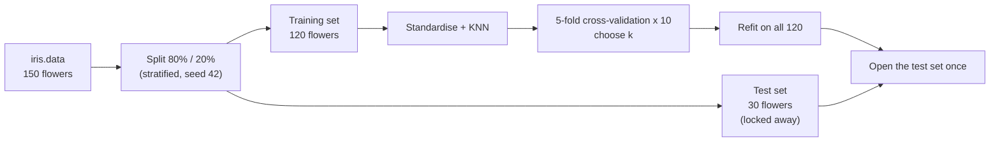
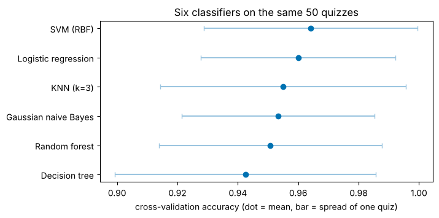
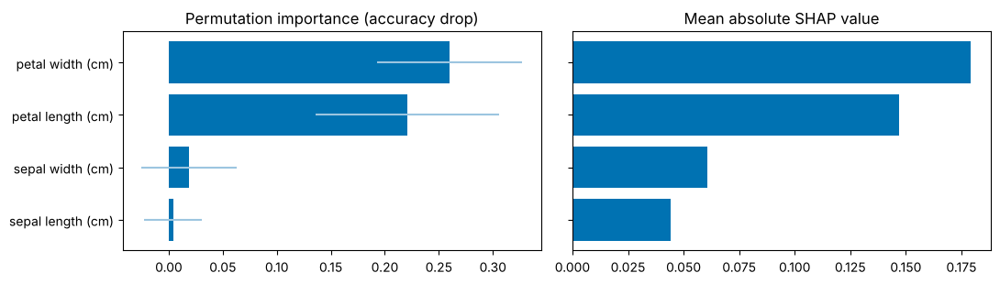
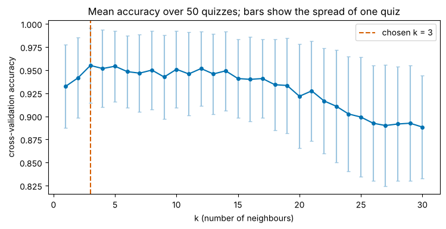
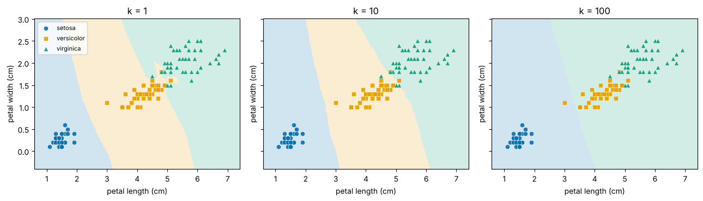

# KNN on Iris: a step-by-step tutorial

**After this tutorial you will be able to** train a K-nearest-neighbours classifier, choose its `k` with cross-validation, and judge its result honestly.

| | |
|---|---|
| Who it is for | Learners who know basic Python and have seen a data table. No machine learning needed. |
| Prerequisites | Python, `pandas` basics. |
| Time | About 30 to 40 minutes per notebook. Every notebook runs in seconds on a CPU. |
| Random seed | `42` everywhere, so you get the same numbers as shown here. |

## What you will learn

- How KNN decides: the nearest labelled examples vote.
- Why a held-out test set and a fixed random seed matter.
- How distance and feature scales interact (and a trap that breaks KNN).
- How to choose `k` with repeated 5-fold cross-validation, and how to read the result.
- Why a test set of 30 flowers cannot separate two similar models.
- How to compare several classifiers fairly, and why "no clear winner" is a valid result.
- How to explain a KNN prediction with its neighbours, permutation importance, SHAP and LIME, and what to do when explanations disagree.

## The pipeline in one picture



## Contents

| Notebook | Question it answers |
|---|---|
| [01 · The problem and the KNN idea](notebooks/01_the_problem_and_the_knn_idea.ipynb) | What is KNN, what does the data look like, and why can one accuracy number mislead? |
| [02 · Distance, k and cross-validation](notebooks/02_distance_k_and_cross_validation.ipynb) | Which `k`? Does scale matter? How do we measure fairly? |
| [03 · Is KNN the right model?](notebooks/03_is_knn_the_right_model.ipynb) | How do six classifiers compare on the same split and quizzes? |
| [04 · Explaining KNN with SHAP and LIME](notebooks/04_explaining_knn_with_shap_and_lime.ipynb) | Why did it choose that species, and do the explanations agree? |

## How to run

**On Google Colab** (notebooks 03 and 04 need `pip install shap lime` in Colab; see `requirements.txt` for the tested versions):

[](https://colab.research.google.com/github/maryammahmoudi1993/KNN_IRIS_classification/blob/main/notebooks/01_the_problem_and_the_knn_idea.ipynb)
[](https://colab.research.google.com/github/maryammahmoudi1993/KNN_IRIS_classification/blob/main/notebooks/02_distance_k_and_cross_validation.ipynb)
[](https://colab.research.google.com/github/maryammahmoudi1993/KNN_IRIS_classification/blob/main/notebooks/03_is_knn_the_right_model.ipynb)
[](https://colab.research.google.com/github/maryammahmoudi1993/KNN_IRIS_classification/blob/main/notebooks/04_explaining_knn_with_shap_and_lime.ipynb)

**On your computer** (tested with Python 3.13):

```bash
git clone https://github.com/maryammahmoudi1993/KNN_IRIS_classification.git
cd KNN_IRIS_classification
python -m venv .venv
source .venv/bin/activate        # on Windows: .venv\Scripts\activate
pip install -r requirements.txt
python -m pytest -q              # runs the smoke tests and every notebook
```

Then open the notebooks in `notebooks/` with the editor you prefer (for example VS Code, or JupyterLab installed separately; it is not part of the pinned requirements).

## Results

All numbers come from `notebooks/02_distance_k_and_cross_validation.ipynb` (seed 42, 120 training and 30 test flowers). Cross-validation is 5-fold repeated 10 times on the training set; "+/-" is the spread of one quiz, not a confidence interval.

| Model | CV accuracy (training set) | Test flowers correct |
|---|---|---|
| `k = 1` with standardised features (the original script's choice) | 0.932 +/- 0.045 | 29 / 30 |
| `k = 3` with standardised features (chosen by cross-validation) | 0.955 +/- 0.041 | 28 / 30 |

Two honest readings: cross-validation prefers `k=3`, yet `k=3` gets one test flower fewer right. One flower is 3.3 points, so the 30-flower test set cannot tell the two apart. And in notebook 01, the *same* `k=1` model scored anywhere from 80% to 100% across 30 random splits of 15 test flowers, which is why my first script's single number was not reliable.

### Comparing models (notebook 03)

Same split, same 50 quizzes for every model (scikit-learn defaults; KNN uses the `k=3` from above). Seed 42.

| Model | CV accuracy (training set) | Test flowers correct |
|---|---|---|
| Majority class (baseline) | 0.333 +/- 0.000 | 10 / 30 |
| KNN (k=3) | 0.955 +/- 0.041 | 28 / 30 |
| Logistic regression | 0.960 +/- 0.032 | 28 / 30 |
| Decision tree | 0.943 +/- 0.043 | 28 / 30 |
| SVM (RBF) | 0.964 +/- 0.035 | 29 / 30 |
| Random forest | 0.951 +/- 0.037 | 27 / 30 |
| Gaussian naive Bayes | 0.953 +/- 0.032 | 29 / 30 |

All real models are within about two percentage points of each other, much less than the spread, so **no model clearly wins on Iris**. KNN's `k` was tuned by cross-validation and the others were not, which gives KNN a very small head start.



*Mean cross-validation accuracy (dot) and spread of one quiz (bar). Notice how much the bars overlap.*

### Explaining the model (notebook 04)

Permutation importance and mean absolute SHAP value rank the measurements the same way: petal width, petal length, then the sepal ones far behind. For the one flower studied in detail (a *virginica* named *versicolor*), the neighbours show that the nearest one was correct but was outvoted 2 to 1, while SHAP and LIME disagree on the sign of the petal width's effect.



*Two different methods, same ranking of the four measurements.*



*Mean cross-validation accuracy for each `k`. Notice the flat region of good values for small `k` and the drop for large `k`.*



*Decision regions for three values of `k`. Notice the small islands at `k=1`, and how the middle species disappears at `k=100`.*

## Learning journey

| | |
|---|---|
| **Then (August 2022)** | The first version is a 42-line script in [`legacy/IRIS.py`](legacy/IRIS.py). It reads the UCI Iris file with `pandas`, splits it 90/10 without a random seed, trains `KNeighborsClassifier(n_neighbors=1)` and prints one accuracy from a test set of 15 flowers. Re-running it gave 86.67%, 93.33% and 100% in three runs. |
| **Now** | The same idea is rebuilt as a lesson: a fixed seed, a stratified split, repeated cross-validation to choose `k`, honest reporting of the spread, and notebooks that explain each step. |
| **Also added** | A comparison with other models (notebook 03) and explanations of KNN's decisions with neighbours, SHAP and LIME (notebook 04). |

## Limitations

- Iris is tiny and easy: 150 flowers, three well-separated groups. Conclusions about `k` do not transfer directly to large or noisy data.
- The test set has 30 flowers, so its accuracy is coarse (steps of 3.3 points).
- `k` was chosen on one training split. A different seed can give a different (equally good) `k`.
- The UCI file has two rows that differ from Fisher's paper; they are kept as downloaded (see `data/README.md`).

## Further reading

- scikit-learn user guide, [Nearest Neighbors](https://scikit-learn.org/stable/modules/neighbors.html) and [Cross-validation](https://scikit-learn.org/stable/modules/cross_validation.html).
- T. Cover and P. Hart (1967), *Nearest neighbor pattern classification*, IEEE Transactions on Information Theory 13(1), 21-27.
- R. A. Fisher (1936), *The use of multiple measurements in taxonomic problems*, Annals of Eugenics 7(2), 179-188.
- Iris data set, [UCI Machine Learning Repository](https://archive.ics.uci.edu/dataset/53/iris). Please check that page for the current license and citation terms.

## License

MIT, see [`LICENSE`](LICENSE). The data files come from the UCI repository (see above).
